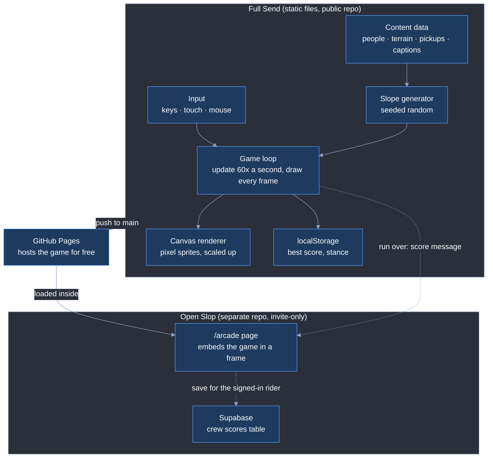

# Full Send: systems guide

A plain-language guide to each piece Full Send uses, what it does here, and why. 🟢 built · 🟡 planned · ⚪ optional

## How the pieces connect

The game itself never talks to a server. That keeps the public version simple (no accounts, nothing to secure). Only when it runs **inside Open Slop** does it hand its score to the page around it, and Open Slop (which already knows who you are) saves it.

## Systems

| System | Status | What it is | What it does here | Why it matters |
|---|---|---|---|---|
| **HTML `<canvas>`** | 🟢 | A blank drawing surface in a web page that JavaScript paints pixels onto | Draws the slope, rider, obstacles and HUD every frame | Fast, built into every browser, no libraries needed |
| **Fixed-timestep game loop** | 🟢 | The heartbeat of a game: "move everything a little, then draw" on repeat. Fixed timestep means the moving happens at a steady 60 steps a second however fast the screen draws | Runs physics, collisions and spawning | The game plays the same speed on a gaming PC and an old phone |
| **Pixel-art scaling** | 🟢 | Draw at a tiny resolution (about 320×480) and blow it up with sharp, unblurred pixels | Gives the early-90s look | Small art is quick to make and reads clearly on a phone |
| **Sprite sheets** | 🟡 (the prototype draws placeholder shapes in code) | One PNG holding many small pictures (frames) side by side | Rider poses, people, trees, animations | One file to load; animating is just picking the next frame |
| **Seeded random generator** | 🟢 | A random-number maker that gives the same sequence for the same starting number (the seed) | Builds the endless mountain | Same seed = same mountain, which makes Daily send and fair leaderboards possible |
| **Zones** | 🟢 | Bands of mountain (64 m each), each with its own mix of trees, jumps and people, picked by the seed | Groomers (default), Terrain park (open snow, jump lines) and Glades (heavy trees), with a banner as you enter | Variety, and a breather between busy stretches |
| **Content as data** | 🟡 (M1: the prototype's mix lives in `ZONES` in `src/game.js`) | Every obstacle, person and pickup is an entry in a list, not custom code | The engine reads [CONTENT.md](CONTENT.md)'s items from a `content` file | Adding a new joke is quick, so the catalog can keep growing (PRD §6) |
| **Collision boxes** | 🟢 | Each thing has a small invisible rectangle; overlapping rectangles mean a hit | Crashes, pickups, rails | Simple and predictable; boxes are smaller than the art so near misses feel fair |
| **Input layer** | 🟢 | Turns keys, touches and mouse moves into the same few actions (steer, ollie, spin, grab) | Lets one game work on phone and desktop | The rest of the code never cares which device you're on |
| **localStorage** | 🟢 | A small key-value store the browser keeps per site | Best score, stance, sound on/off | No account needed; wrapped in try/catch so a private window still works |
| **GitHub Pages** | 🟢 | GitHub's free hosting for static files from a public repo | Serves the game at https://elbrownbear.github.io/full-send/, redeploying on every push to `main` | Free, no new account, and the repo is already public |
| **Open Slop link** | 🟡 | A button in Open Slop that opens the game URL | First way in for the crew | Zero changes to the game |
| **Open Slop embed (`/arcade`)** | 🟡 | An Open Slop page that shows the game inside a frame (`<iframe>`) | Makes the game feel built into the crew's app, including the installed phone app | The game hides its own header when loaded with `?embed=openslop` |
| **Frame-to-page messages (`postMessage`)** | 🟡 | The browser's safe way for a framed page and the page around it to pass notes | The game hands its final score to Open Slop | The game stays server-free; Open Slop checks the message came from the game's address |
| **Crew leaderboard (Supabase)** | 🟡 | A new table in Open Slop's existing database | Saves each rider's scores and shows a crew board | Uses logins Open Slop already has |
| **Web Audio** | ⚪ | The browser's built-in sound engine | Bleeps, crash sounds, an optional chiptune | Small and dependency-free; muted by default on phones |
| **Interactive mock (claude.ai Artifact)** | ⚪ | A clickable prototype page | Trying the look before building the engine | Cheap way to agree on style (PRD §12 Q3) |
